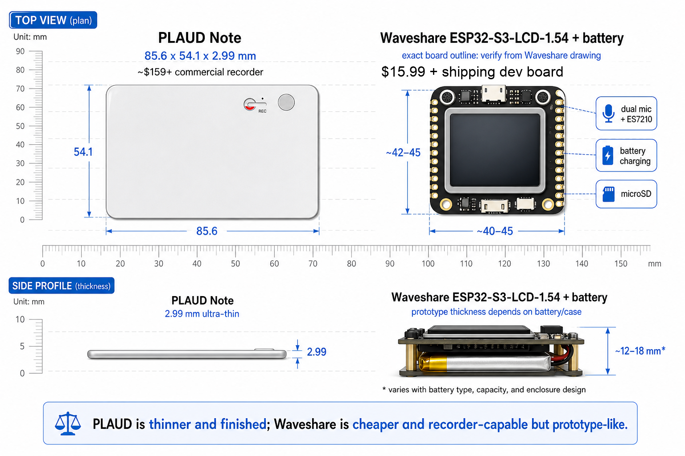

# open-plaud

An open reference stack for a Plaud-like recorder: DIY ESP32-S3 hardware, firmware that records and syncs WAV files, and a self-hosted transcription/summarization server you control.

No per-minute limits. No forced cloud lock-in. No subscription. You own the recordings and the pipeline.

> This project is independent and is not affiliated with, endorsed by, or
> sponsored by Plaud. See `docs/PRIOR_ART.md` for naming and positioning notes.

## Why

Commercial AI recorders ship cheap hardware and monetize a cloud subscription that caps your transcription minutes and processes your private audio on someone else's servers. `open-plaud` inverts that: the value lives in an open pipeline you run yourself.

| | Plaud (commercial) | open-plaud |
|---|---|---|
| Hardware | Closed, ~$159+ | Open, ~₩40–70k DIY |
| Transcription | Cloud-only, minute-capped | Pluggable: cloud (OpenAI) or local (whisper.cpp) |
| Summarization | Their templates | Claude or local Ollama |
| Recordings | Their cloud | Your storage |
| Cost model | Subscription | Pay-per-use or free (local) |

## Repository layout

```
open-plaud/
├── firmware/      ESP32-S3 firmware (ESP-IDF) — record, sync over Wi-Fi
├── hardware/      BOM, 3D-print case files, pilot PCB notes
├── mobile/        iOS on-device transcription package
├── server/        Python pipeline: ingest → transcribe → diarize → summarize
├── docs/          Architecture, roadmap, hardware decisions, prior art, research
└── .github/       CI for server checks
```

## Status

The server loop works end to end: upload → transcribe → summarize → browse.
Cloud transcription (OpenAI Whisper), local desktop transcription
(`whisper_cpp`), on-device iOS transcription, cloud summarization (Claude),
local summarization (Ollama), and optional `pyannote` / `whisperx` diarization
are implemented behind small provider contracts; recordings persist in SQLite
and survive restarts; a small web UI lists, plays, and exports them. The default
server providers are `none` (no key required) so the server runs offline out of
the box. See `docs/ARCHITECTURE.md` and `docs/ROADMAP.md`.

Related-project research and positioning notes live in `docs/PRIOR_ART.md` and
`docs/POSITIONING.md`.

Current v0 hardware target: **Waveshare ESP32-S3-LCD-1.54 + battery**. It keeps
the important recorder pieces under $30: dual mic + ES7210 ADC, battery
charging, TF/microSD, Wi-Fi, and a small status LCD.

First-board validation is tracked in `docs/BRINGUP.md`. Do not treat the
hardware reference as public-alpha complete until the bring-up checklist has
real serial logs, WAV samples, upload responses, and case-fit evidence.



Plaud is much thinner and more finished; the Waveshare board is cheaper,
open-firmware friendly, and already includes the pieces needed for a working v0
recorder prototype.

## Quick start (server)

This project is **uv-managed**. Install [uv](https://docs.astral.sh/uv/), then:

```bash
cd server
uv sync                                        # create .venv + install from uv.lock
cp .env.example .env                           # add your transcription + LLM API keys
uv run uvicorn open_plaud.api.app:app --reload
```

Then open **http://127.0.0.1:8000/** for the web UI (list, play, transcript,
summary, Markdown export), or use the device upload target directly:

```bash
curl -F "file=@rec_0001.wav;type=audio/wav" http://127.0.0.1:8000/v1/recordings
# -> {"id":"...","status":"received","filename":"rec_0001.wav","size_bytes":...}
# the pipeline runs in the background; poll GET /v1/recordings/{id} for the result
```

By default the pipeline is a no-op (stores audio, empty transcript) so it runs
with no API keys. To actually transcribe + summarize, set the keys in `.env` and
select the cloud providers:

```bash
OP_PIPELINE__TRANSCRIPTION=openai_whisper   # needs OPENAI_API_KEY
OP_PIPELINE__SUMMARIZATION=claude           # needs ANTHROPIC_API_KEY
```

Local desktop transcription uses an installed whisper.cpp CLI and model:

```bash
OP_PIPELINE__TRANSCRIPTION=whisper_cpp
OP_WHISPER_CPP_MODEL=/path/to/ggml-model.bin
# OP_WHISPER_CPP_BIN=whisper-cli            # override if your binary name differs
```

Local summarization uses a running Ollama server:

```bash
OP_PIPELINE__SUMMARIZATION=ollama
OP_OLLAMA_MODEL=qwen2.5:7b                  # or any model installed in Ollama
```

See `server/.env.example` for the `whisper_cpp`, Ollama, and diarization
settings.

`uv` reads the pinned interpreter from `.python-version` (installing it if missing).
Dev tools (pytest, ruff, mypy) come with `uv sync` — run them via `uv run pytest`,
`uv run ruff check .`, `uv run mypy .`.

## License

MIT. See `LICENSE`.
