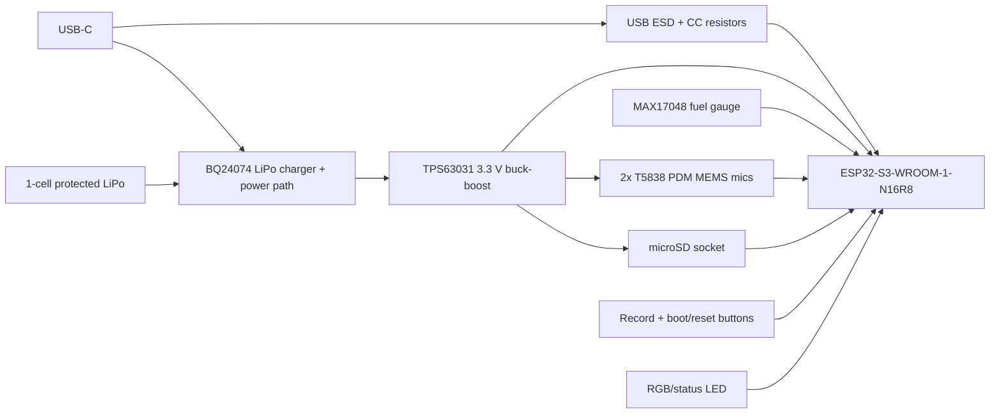

# Open Plaud custom PCB Rev A

This is the first custom-board direction for replacing the Waveshare development
board. It is intentionally not a full Waveshare clone. The goal is a recorder
PCB that is easier to manufacture, debug, and certify in a 100-unit Seoul pilot.

## First-principles decision

What is actually being built:

- A thin battery recorder that captures voice locally.
- Storage-first behavior: write WAV to microSD reliably, then upload over Wi-Fi.
- USB-C for charging, flashing, logs, and emergency file access later.
- No subscription-dependent hardware path.

What is not required for Rev A:

- Speaker playback.
- LCD/touch UI.
- Analog codec output.
- IMU.
- Voice assistant wake-word hardware.

The Rev A board should therefore remove the display, speaker amp, ES8311 DAC,
and ES7210 analog mic ADC from the Waveshare-style design. Those parts are useful
for a voice assistant, but they add layout, firmware, and sourcing risk for a
voice recorder. Digital MEMS microphones connected directly to ESP32-S3 are the
lower-risk recorder path.

## Selected architecture



## Primary components

| Function | Selected part | Why |
|---|---|---|
| MCU/radio | ESP32-S3-WROOM-1-N16R8 | Integrated antenna module, 16 MB flash, 8 MB PSRAM, native USB, mature ESP-IDF support |
| Microphones | 2x TDK T5838 PDM MEMS | Production-status digital PDM mic, high SNR, no analog ADC routing |
| Storage | Push-push microSD socket | Keeps long recordings local; avoids large onboard flash cost |
| Charger / power path | TI BQ24074 | Charges 1-cell LiPo while powering system from USB; avoids simple charger load-sharing problems |
| 3.3 V rail | TI TPS63031 fixed 3.3 V buck-boost | Maintains stable 3.3 V across LiPo discharge and ESP32 Wi-Fi current bursts |
| Battery gauge | MAX17048 | Gives battery percentage without current-sense resistor calibration |
| USB protection | USBLC6-2SC6 or equivalent | Protects native USB D+/D- lines |
| UI | Record button, reset/boot buttons, RGB LED | Enough for Rev A: recording, syncing, battery/error states |

## Deliberately deferred

| Deferred item | Reason |
|---|---|
| LCD/e-paper | Adds cost, thickness, power, firmware surface; LED states are enough for pilot |
| Speaker / ES8311 | Recorder does not need playback |
| ES7210 analog ADC | Better if using analog mic arrays later, but not needed for first custom PCB |
| 4-mic beamforming | Layout pads can reserve expansion, but firmware and test scope should start at stereo |
| Wireless charging | Mechanical and thermal risk before the basic recorder is proven |

## Rev A electrical contract

Power:

- Input: USB-C 5 V.
- Battery: 1-cell protected LiPo, JST/MX 1.25 2-pin, target 500-800 mAh.
- System rail: 3.3 V from TPS63031.
- Charge current: set conservatively around 500 mA unless final battery supports more.
- Add test pads for VBAT, VSYS, 3V3, GND, CHG, PGOOD.

Audio:

- Start with two populated T5838 microphones.
- Route PDM CLK and DATA0 with short, clean traces and local decoupling.
- Add optional unpopulated footprints for two more T5838 microphones on DATA1.
- Keep microphone acoustic ports clear of soldermask, case ribs, adhesive, and foam.

Storage:

- microSD on SDMMC 4-bit if routing permits; allow fallback to 1-bit in firmware.
- Series damping resistors near ESP32 on CLK/CMD/DAT lines: 22-33 ohm DNI/fit option.
- Add card-detect switch if socket supports it.

USB:

- Native USB only: no CP210x bridge on Rev A.
- USB D-/D+ to ESP32-S3 GPIO19/GPIO20 through ESD protection.
- USB-C CC1/CC2 each with 5.1 k pulldown.

RF:

- Use ESP32-S3-WROOM-1 with PCB antenna.
- Place module on board edge with Espressif antenna keepout respected.
- No copper, battery, screws, or magnets inside the antenna keepout.

## Proposed pin map

| Signal | ESP32-S3 GPIO | Notes |
|---|---:|---|
| USB D- | 19 | Native USB |
| USB D+ | 20 | Native USB |
| PDM CLK | 8 | I2S0 PDM clock |
| PDM DATA0 | 9 | Stereo pair A |
| PDM DATA1 | 10 | Optional future pair B |
| MIC_EN | 11 | Optional mic power gate |
| SD CLK | 14 | SDMMC |
| SD CMD | 15 | SDMMC |
| SD D0 | 16 | SDMMC |
| SD D1 | 17 | SDMMC, optional for 4-bit |
| SD D2 | 18 | SDMMC, optional for 4-bit |
| SD D3 | 21 | SDMMC, optional for 4-bit |
| SD_DET | 7 | Socket detect, pull-up |
| I2C SDA | 42 | Fuel gauge |
| I2C SCL | 41 | Fuel gauge |
| REC button | 4 | Wake-capable input preferred |
| RGB LED R/G/B | 35 / 36 / 37 | Use low current |
| CHG status | 5 | From charger open-drain |
| PGOOD | 6 | From charger open-drain |
| BOOT | 0 | Boot button only |
| RESET/EN | EN | Reset button |

Pins should be rechecked against the exact ESP32-S3-WROOM-1 module symbol and
strap-pin behavior before schematic release. Do not put strong external pulls on
strapping pins other than the standard boot circuit.

## PCB stackup and layout

Recommended Rev A board:

- 4-layer FR-4, 1.0 mm or 0.8 mm thickness.
- L1: components and signals.
- L2: uninterrupted ground plane.
- L3: power and secondary signals.
- L4: signals, microphone ports if bottom-port mics are bottom-mounted.
- ENIG finish for microphone pads, USB-C, and reliability.
- Target outline: 65 mm x 32 mm before case constraints are finalized.
- Put USB-C on a short edge, microSD accessible from side, record button on side.
- Put the two main microphones near opposite ends of the long edge for spacing.
- Keep the buck-boost inductor away from microphones and antenna.
- Provide SWD/JTAG or UART pads plus native USB logs; add at least 6 test pads for
  bed-of-nails pilot testing.

## Firmware impact

Rev A should switch `firmware/main/board.h` away from the Waveshare LCD-1.54 pin
map after the PCB schematic is committed. The first firmware milestone should be:

1. Boot over native USB.
2. Mount microSD.
3. Capture mono/stereo PCM from PDM mic pair.
4. Write 16 kHz and 48 kHz WAV files.
5. Upload over Wi-Fi using the existing server endpoint.
6. Show state through LED: idle, recording, syncing, error, low battery.

The repo now has an opt-in Rev A compile profile:

```bash
cd firmware
idf.py -B build-rev-a -DSDKCONFIG=build-rev-a/sdkconfig \
  -DSDKCONFIG_DEFAULTS="sdkconfig.defaults;sdkconfig.rev_a.defaults" build
```

This validates ESP-IDF API compatibility for the proposed ESP32-S3 PDM RX pins
and RGB status pins. It does not replace schematic ERC, PCB DRC, microphone
select/polarity review, or first-board audio validation.

## GitHub / ecosystem activity check

The support landscape is good at the Espressif layer, weaker at the random
project layer:

- `espressif/esp-idf` is highly active and is the safe base for USB, SDMMC, Wi-Fi,
  and I2S/PDM.
- `espressif/esp-adf` is active and useful as a reference, though this project can
  stay on plain ESP-IDF unless audio pipelines become complex.
- GitHub search for exact ESP32-S3 + ES7210 recorder examples is sparse. Treat
  community ES7210 repos as examples, not as a foundation.
- ESP-IDF has documented ESP32-S3 PDM RX and an `i2s_recorder` style path for
  digital MEMS microphone to WAV on SD card, which matches this board.

Conclusion: the custom PCB should anchor on official ESP-IDF-supported
peripherals, not on Waveshare-specific example code.

## Manufacturing estimate at 100 units

This is a first-pass landed-cost range, not a quote:

| Item | Estimate per unit |
|---|---:|
| Assembled PCB, no battery/case/microSD | USD 20-35 |
| Battery | USD 3-7 |
| microSD 64 GB | USD 5-10 |
| Case + buttons + adhesive | USD 4-12 |
| Flashing/test/packaging allowance | USD 3-8 |
| Total pilot unit cost | USD 35-72 |

At 100 units this custom board is not guaranteed to beat Waveshare on cost. The
reason to do it is product shape, control, testability, and future cost-down at
500-1000+ units.

## Release gates before ordering Rev A

- [ ] Schematic ERC passes.
- [ ] PCB DRC passes using JLCPCB or local EMS constraints.
- [ ] Antenna keepout reviewed against Espressif module datasheet.
- [ ] Power tree reviewed against Wi-Fi TX current peaks.
- [ ] One microphone footprint printed 1:1 and checked against port/case geometry.
- [x] Firmware branch compiles with the proposed pin map.
- [ ] EMS confirms T5838, BQ24074, TPS63031, MAX17048 sourcing or approved alternates.
